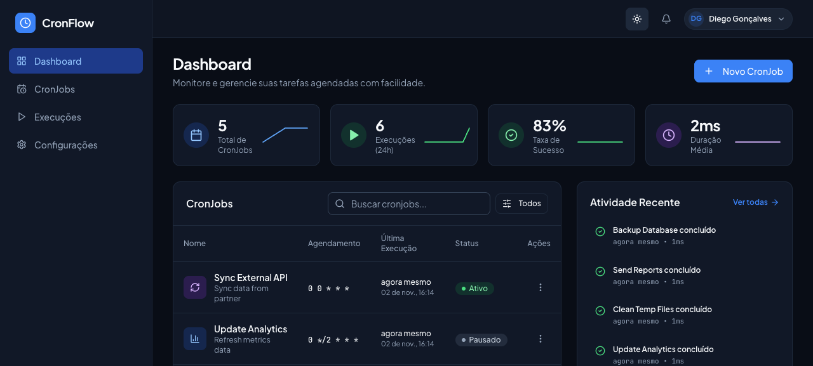
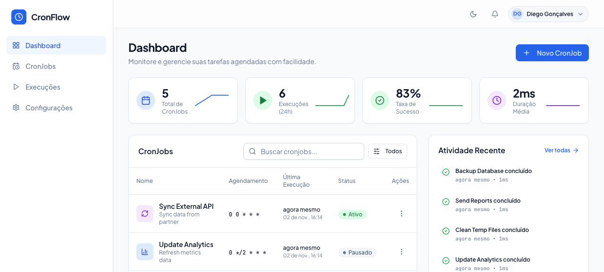
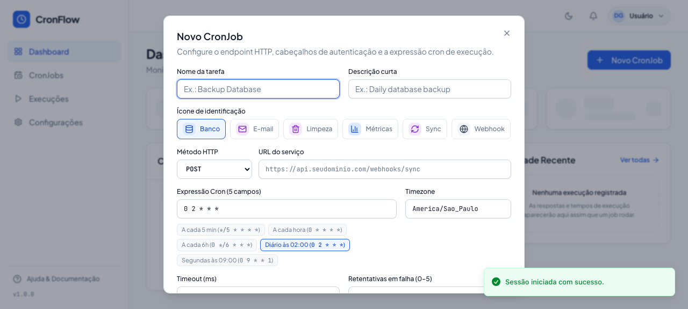
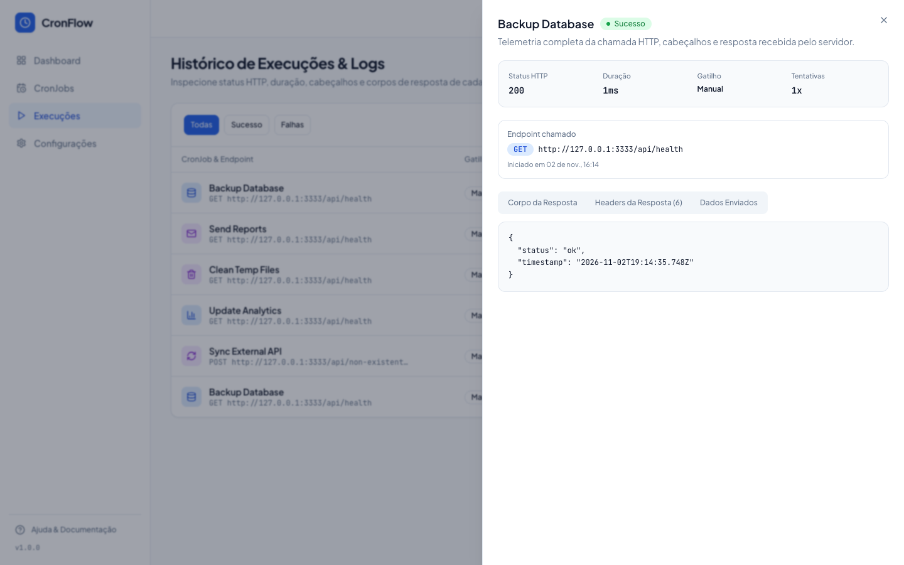

# CronFlow

HTTP scheduled task manager (CronJobs) with an in-process execution engine, exponential backoff retries, and full response payload inspection.


---

## Screenshots

### Dashboard (Dark Theme)


<details>
<summary>☀️ Click to preview Light Mode Dashboard</summary>


</details>

### Job Scheduling & Execution Inspection
| Create & Configure Cron Job | Real-Time Execution Inspector |
|:---:|:---:|
|  |  |

---

## Why CronFlow

Shell scripts buried in a Linux server's `crontab` fail silently when a TLS certificate expires, a database query stalls, or an upstream API returns `HTTP 502`. By the time someone notices, a nightly settlement or data sync has been broken for days and the response body is gone.

**CronFlow** centralizes HTTP endpoint scheduling (`GET`, `POST`, `PUT`, `PATCH`, `DELETE`) in a web dashboard backed by **SQLite** (development and tests) and **PostgreSQL** (production):

- **5-field POSIX Cron with IANA timezones**: each job runs in its configured timezone (`America/Sao_Paulo`, `UTC`, etc.) using `croner` with `protect: true` enabled so an overlapping tick is skipped if the previous request is still in flight.
- **Automatic exponential backoff**: responses outside `200–299` or socket timeouts trigger up to 5 retries with fixed delays of `500ms`, `1s`, `2s`, `4s`, and `8s`.
- **64 KB response inspection**: every run records HTTP status code, latency in milliseconds, attempt count, response headers, and the first `65,536 bytes` of the response body.
- **SSRF protection**: configurable blocking of loopback (`127.0.0.1`, `localhost`) and private IP ranges in production via `ALLOW_PRIVATE_NETWORKS`.

---

## Monorepo Architecture

```text
cron-schedule/
├── apps/
│   ├── api/                  # Fastify 5 + Zod + Drizzle ORM (SQLite dev/test & PostgreSQL prod) + Croner
│   │   ├── drizzle/          # SQL migrations generated by drizzle-kit (SQLite and PostgreSQL)
│   │   ├── src/
│   │   │   ├── domain/       # Entities (User, CronJob, ExecutionLog), UUIDv7, and domain errors
│   │   │   ├── application/  # Ports and Use Cases decoupled from infrastructure
│   │   │   ├── infra/        # SQLite & PostgreSQL repositories, CronerSchedulerAdapter, FetchHttpExecutor
│   │   │   └── http/         # Fastify routes, plugins (JWT, CORS, Swagger), and presenters
│   │   └── tests/            # Unit and integration test suites (Vitest)
│   └── web/                  # React 19 + Vite 6 + Tailwind v4 + Base UI (shadcn base-nova)
│       └── src/
│           ├── api/          # Per-endpoint HTTP functions + MSW handlers for tests
│           ├── components/   # UI primitives, Sparkline charts, and Donation modal
│           └── pages/        # Dashboard (/), CronJobs (/cron-jobs), Executions (/executions),
│                             # Settings (/settings), Documentation (/docs), and Auth
├── biome.json                # Single linter and formatter across the workspace
├── pnpm-workspace.yaml       # pnpm workspace definition
└── LICENSE                   # MIT License
```

---

## Requirements & Quick Start

- **Node.js** `>= 20` (tested on Node 22 and Node 24)
- **pnpm** `>= 9`

```bash
# 1. Install dependencies across all workspace packages
pnpm install

# 2. Start both the API (port 3333) and Web UI (port 5173)
pnpm dev
```

- **Web UI**: `http://localhost:5173`
- **HTTP API**: `http://localhost:3333`
- **OpenAPI / Swagger Docs**: `http://localhost:3333/docs`

---

## Environment Variables

### Backend (`apps/api`)

| Variable | Default | Description |
|---|---|---|
| `NODE_ENV` | `development` | Runtime environment (`development` and `test` use SQLite; `production` requires PostgreSQL). |
| `PORT` | `3333` | Fastify HTTP server port. |
| `HOST` | `0.0.0.0` | Server bind address. |
| `DATABASE_URL` | `./data/cronflow.db` (dev/test) / `postgresql://...` (prod) | SQLite file path in `development`/`test`, or a `postgresql://` connection string in `production`. |
| `JWT_SECRET` | `cronflow-super-secret-jwt-key-2026` | Secret key used to sign and verify JWT tokens (must be >= 32 chars and non-default in production). |
| `ALLOW_PRIVATE_NETWORKS` | `true` in dev / `false` in prod | Allows or blocks webhook calls to `localhost` and private IP ranges (`10.x`, `172.16-31.x`, `192.168.x`, `169.254.x`). |
| `CORS_ORIGIN` | `true` in dev / `false` in prod | Allowed CORS origin (`true`, `false`, single URL, or comma-separated URLs). |

### Frontend (`apps/web`)

| Variable | Default | Description |
|---|---|---|
| `VITE_API_URL` | `http://localhost:3333` | Base URL for the Fastify API. |
| `VITE_DONATION_PIX_KEY` | `your-pix-key` | PIX key displayed in the donation dialog and `/docs` page. |
| `VITE_DONATION_SPONSOR_URL` | `https://github.com/sponsors/dsg1407` | External sponsorship URL (GitHub Sponsors / Buy Me a Coffee). |

---

## Core API Endpoints

All routes under `/api/dashboard`, `/api/cron-jobs`, `/api/executions`, and `/api/profile` require an `Authorization: Bearer <token>` header.

| Method | Route | Description |
|---|---|---|
| `GET` | `/api/health` | Server health check (`200 OK`). |
| `POST` | `/api/auth/register` | Registers a user account and returns a JWT token. |
| `POST` | `/api/auth/login` | Authenticates a user by email and password. |
| `GET` | `/api/profile` | Returns the authenticated user's profile and operational defaults. |
| `PUT` | `/api/profile/settings` | Updates default timezone, timeout, retries, and log retention window. |
| `GET` | `/api/dashboard/summary` | 24h KPI metrics, sparkline series, and recent activity feed. |
| `GET` | `/api/cron-jobs` | Lists paginated CronJobs with search, status filter, and next run timestamp. |
| `POST` | `/api/cron-jobs` | Creates a new CronJob and schedules it immediately in `Croner`. |
| `PUT` | `/api/cron-jobs/:cronJobId` | Updates a CronJob definition and resyncs the active schedule. |
| `PATCH` | `/api/cron-jobs/:cronJobId/status` | Toggles a CronJob between `active` and `paused`. |
| `POST` | `/api/cron-jobs/:cronJobId/trigger` | Triggers an immediate manual execution and records the result. |
| `DELETE` | `/api/cron-jobs/:cronJobId` | Deletes a CronJob, cancels its active timer, and removes associated logs. |
| `GET` | `/api/executions` | Lists paginated execution history with status, trigger, and job filters. |
| `GET` | `/api/executions/:executionId` | Returns full execution details including `responseBody` and `responseHeaders`. |
| `DELETE` | `/api/executions/purge` | Purges execution logs older than the configured retention period. |

---

## Quality & Test Scripts

```bash
# Run all test suites (API unit + integration tests + Web component/page tests)
pnpm test

# Run TypeScript typechecking across all packages
pnpm typecheck

# Run Biome linter and formatting checks
pnpm lint

# Generate SQLite (dev) or PostgreSQL (production) Drizzle migrations
pnpm --filter @cronflow/api db:generate
pnpm --filter @cronflow/api db:generate:pg

# Build API and Web for production
pnpm build
```

---

## Support the Project (Donation)

**CronFlow** is an independent open-source project released under the MIT License. If it helps keep your team's scheduled jobs reliable, you can support its ongoing maintenance:

- **GitHub Sponsors**: [https://github.com/sponsors/dsg1407](https://github.com/sponsors/dsg1407)
- **In-app**: click **Apoiar o projeto** in the sidebar footer or visit `/docs` inside the application.

---

## License

Released under the **MIT License**. See [LICENSE](./LICENSE) for the full text.

Copyright (c) 2026 **Daniel S. Gonçalves**.
